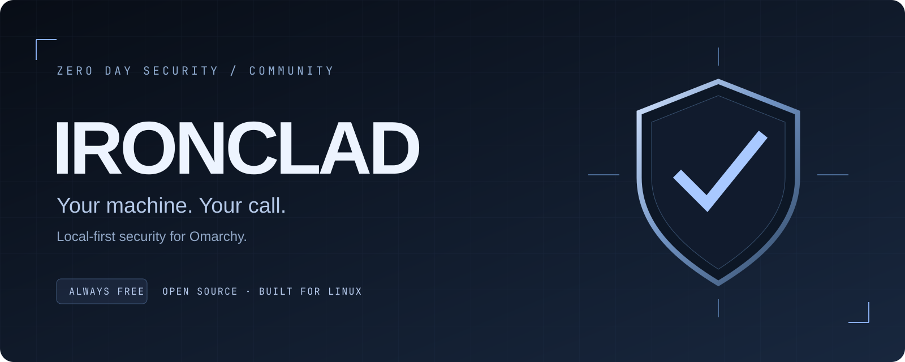
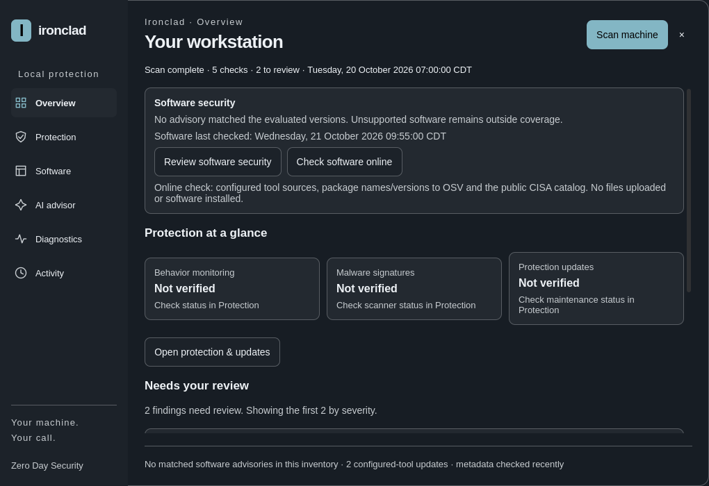
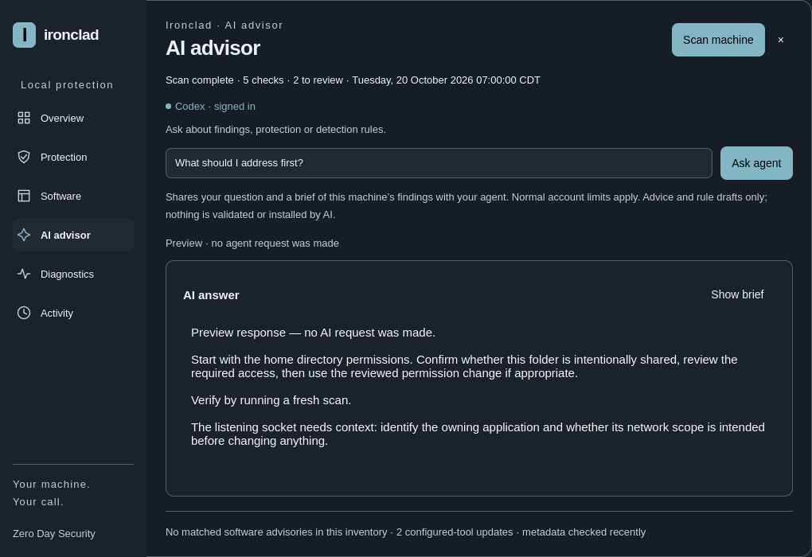
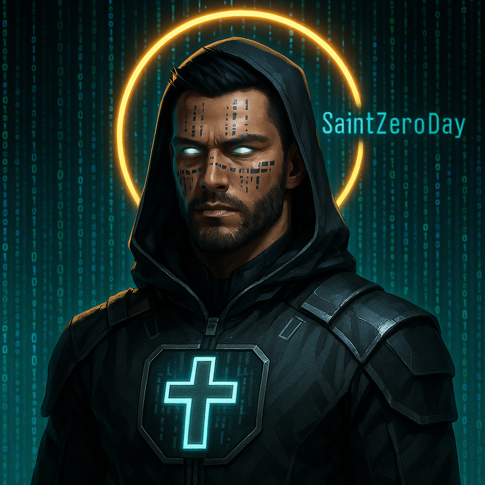

  

> **PREVIEW ONLY — no plugin download yet.**
> Ironclad is being prepared for release as an Omarchy plugin. This public repository contains project information and preview media only. The plugin source, installer, and release packages are not published here. Please wait for the official release before trying to install it.

  <strong>Know what needs attention. Understand why. Choose what happens next.</strong> 
  A security companion built for the Omarchy desktop.

  
  
  

  <a href="#watch-the-preview">Watch</a> ·
  <a href="#inside-ironclad">Explore</a> ·
  <a href="#see-it-in-action">Screenshots</a> ·
  <a href="#get-ironclad">Release status</a> ·
  <a href="docs/ROADMAP.md">Roadmap</a> ·
  <a href="CONTRIBUTING.md">Contribute</a> ·
  <a href="https://szdsecurity.com/">Zero Day Security ↗</a>

---

## Security that makes sense on your desktop

Ironclad brings system findings, behavior monitoring, automatic Downloads malware scanning, one-off file scans, software checks, and AI explanations into one desktop panel. Findings come with context and a next step you can review.

**You stay in control.** Review an observation, ignore it when appropriate, or choose a supported action. Ironclad does not automatically delete your files, quarantine applications, or execute AI suggestions.

## Watch the preview

https://github.com/user-attachments/assets/f65ab5a7-105f-4f9a-9671-d90e7fe9a603

A 73-second walkthrough of the development build on the real Omarchy desktop. **Preview only:** the plugin source, installer, and release packages are not available here yet.

## See it in action

The real QML interface, rendered with synthetic fixtures. Example findings and software versions are illustrative; these images do not report a real machine's security state.

<strong>Open the AI advisor preview</strong>

 

The preview uses a fixture response. No AI request was made to create this screenshot.

## Inside Ironclad

| Surface | What you get |
| :--- | :--- |
| **Overview** | A clear starting point: scan results, protection health, and the next things to review. |
| **Diagnostics** | Quick 90, Full 180, and Super Scan 420: distinct checks with evidence, explicit coverage limits, and Ignore / Restore controls. |
| **Protection** | Falco behavior monitoring, separate automatic Downloads and one-off ClamAV scanning controls, and signature maintenance. |
| **Software** | Supported tool inventory, advisory checks, and reviewed update paths. |
| **AI advisor** | Every selected diagnostic check can receive an explanation, with progress and individual follow-up through your existing supported agent. AI does not execute changes. |
| **Activity** | Local action records and reports. A rescan clears the old display and privately gzip-archives the previous snapshot and completed AI explanations. |

## Local first. Explicit choices.

- **Built around your machine.** Review findings and supported actions from the Omarchy desktop.
- **Optional components are visible.** Monitoring, malware scanning, maintenance, and AI have their own setup and status.
- **AI is optional.** It can use your existing Codex or Claude Code account, subject to that provider's limits. Selected, redacted context is sent to the chosen provider when you request assistance.
- **Evidence before action.** AI answers explain or propose; they do not execute changes on their own.

Local-first does not mean every optional feature is offline. Advisory lookups, protection updates, and AI requests require network access when used.

## Get Ironclad

> **Public release is being prepared.** This repository currently hosts the project presentation and previews. The plugin source, release package, and supported installation instructions have not been published here yet.

The interface above comes from the development build. GitHub’s Download ZIP and clone options currently retrieve presentation files only, not a working plugin. Please wait for an officially announced public release and supported installation instructions. Follow the [release checklist and roadmap](docs/ROADMAP.md) for what comes next.

## What protection means here

Ironclad combines focused checks and optional detection engines. It is not a guarantee that a machine is malware-free. Behavior rules cover selected activity. Automatic scanning shown in the development build scans and alerts on accessed files inside Downloads; it does not block or delete files in that mode. One-off scans cover the file you choose. Software checks cover supported inventory and available advisory data. Catalog totals include observations and explicit unavailable/not-applicable outcomes; they are not a security score. A missing or unhealthy engine must be treated as a coverage gap.

Read the [security policy](SECURITY.md) for reporting guidance. Learn about the underlying tools in the official [Falco documentation](https://falco.org/docs/) and [ClamAV documentation](https://docs.clamav.net/).

## Built with the community

Useful bug reports, clear documentation, accessible UI feedback, and reproducible test cases all help. Start with [contributing](CONTRIBUTING.md).

## From Zero Day Security

  
  &nbsp;
  

<strong>SAINT ZERO DAY</strong> Your machine. Your call.  <a href="https://szdsecurity.com/"><strong>Visit Zero Day Security — szdsecurity.com ↗</strong></a>

Ironclad is a Zero Day Security project, built for Omarchy. Saint Zero Day is the character behind the brand.

Built on the work of the [Omarchy](https://omarchy.org/) community, with behavior monitoring from [Falco](https://falco.org/) and malware scanning from [ClamAV](https://www.clamav.net/).

---

<strong>IRONCLAD</strong> Your machine. Your call. · <a href="LICENSE">MIT licensed</a>

